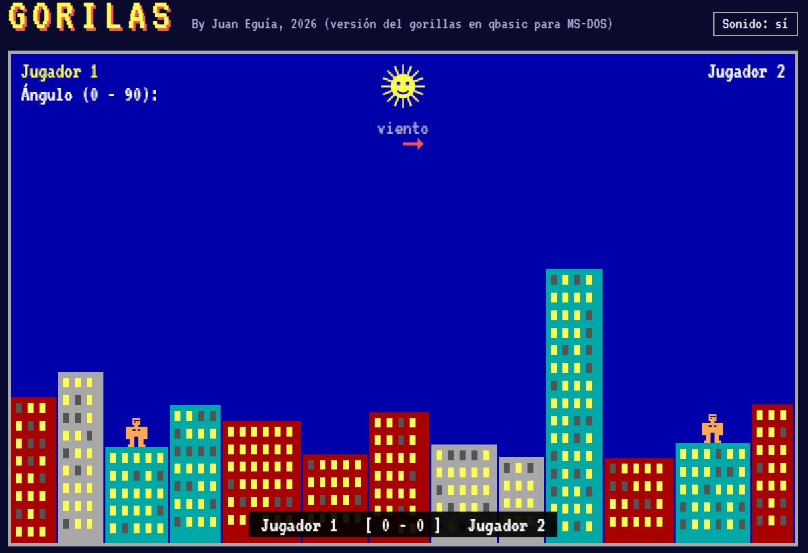
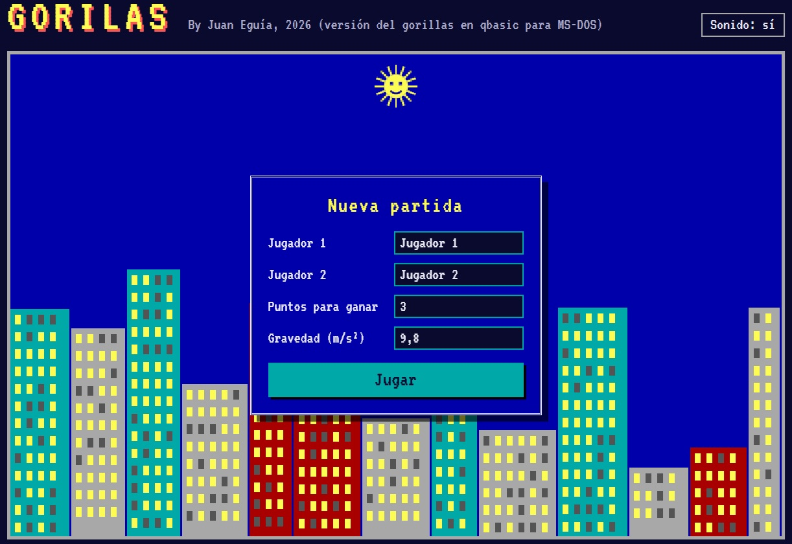

# Gorilas (vanilla JS)

Versión para navegador del clásico **GORILLA.BAS**, el juego que venía con QBasic en MS-DOS. Dos gorilas, cada uno en lo alto de un rascacielos, se lanzan plátanos explosivos por turnos ajustando el ángulo y la velocidad del lanzamiento, con la gravedad y el viento en contra.

Hecho con **HTML, CSS y JavaScript puro** (sin librerías ni frameworks) y dibujado sobre un elemento `<canvas>`.

---




---

**▶ Jugar online:** https://juan1639.github.io/Gorilas-vanillajs/

## Cómo se juega

1. En el menú, escribe los nombres de los dos jugadores, los puntos necesarios para ganar y la gravedad (por defecto 9,8 m/s², la de la Tierra), y pulsa **Jugar**.
2. En tu turno, escribe el **ángulo** (0 a 90 grados) y pulsa `Enter`. Después escribe la **velocidad** (1 a 200) y pulsa `Enter`.
3. El plátano sigue una trayectoria parabólica afectada por la gravedad y por el viento, que cambia en cada ronda y se indica con la flecha bajo el sol.
4. Gana la ronda quien acierte al gorila rival. Si te das a ti mismo, el punto es para el otro.
5. Al terminar la partida: `Enter` para la revancha, `Esc` para volver al menú.

| Tecla | Acción |
|---|---|
| `0`–`9` y `.` | Escribir ángulo o velocidad |
| `Retroceso` | Borrar |
| `Enter` | Confirmar el dato / revancha |
| `Esc` | Volver al menú |

En pantallas táctiles aparece un teclado numérico en pantalla, así que también se puede jugar desde el móvil.

## Características

- Ciudad generada al azar en cada ronda, con edificios destructibles: cada impacto abre un cráter.
- Física con paso de simulación fijo, para que el plátano no atraviese los edificios aunque vaya rápido.
- Viento aleatorio y gravedad configurable.
- Efectos de sonido (con botón para silenciarlos).
- El sol pone cara de sorpresa si el plátano le pasa cerca, como en el original.
- Estética de pantalla EGA de MS-DOS.
- Diseño adaptable a móvil.

## Estructura del proyecto

```
├── index.html        Estructura de la página: canvas, menú y ayuda
├── style.css         Estilos de la página
├── js/
│   ├── main.js       Punto de entrada: carga recursos, crea el juego y conecta la interfaz
│   ├── config.js     Constantes ajustables (tamaños, tiempos, colores, sonidos)
│   ├── juego.js      Lógica: estados, turnos, viento, física del plátano y puntuación
│   ├── render.js     Dibujo en el canvas a partir del estado del juego
│   ├── ciudad.js     Generación de edificios, cráteres y colisiones
│   ├── sprites.js    Sprites dibujados y carga opcional de imágenes PNG
│   ├── sonidos.js    Reproducción de los efectos de sonido
│   └── utilidades.js Funciones auxiliares
└── audio/            Efectos de sonido
```

El código está organizado en **módulos ES** (`import` / `export`). La lógica del juego (`juego.js`) y el dibujo (`render.js`) están separados: `juego.js` actualiza el estado en cada fotograma y `render.js` solo lo lee para pintarlo.

### Algunos detalles técnicos

- **Colisiones con los edificios:** la ciudad se dibuja en un canvas aparte y, para saber si el plátano ha chocado, se consulta el canal alfa del píxel en el que está. Los cráteres se "recortan" con `globalCompositeOperation = 'destination-out'`, así que los edificios dañados dejan de ser sólidos automáticamente.
- **Bucle de juego:** `requestAnimationFrame` con el tiempo entre fotogramas limitado, para que el juego no dé saltos al volver de otra pestaña.
- **Sprites personalizables:** si se crea una carpeta `assets/` junto a `index.html` con estos PNG, el juego los usa en lugar de las figuras dibujadas: `gorila.png`, `gorila_brazo_izq.png`, `gorila_brazo_der.png`, `platano.png`, `sol.png` y `sol_sorprendido.png`. Si falta alguno, se dibuja su figura por defecto.

Los valores del juego (duración de las animaciones, tamaño de los cráteres, fuerza del viento, colores…) se pueden ajustar en `js/config.js`.

## Ejecutarlo en local

Al usar módulos ES, el navegador **no permite abrir `index.html` con doble clic** (bloquea los módulos cargados desde `file://`). Hace falta servirlo con un servidor local, por ejemplo:

- Con la extensión **Live Server** de VS Code: clic derecho en `index.html` → *Open with Live Server*.
- Con Python, desde la carpeta del proyecto:

  ```bash
  python -m http.server
  ```

  y abrir `http://localhost:8000` en el navegador.

## Otras versiones

Este juego forma parte de una serie de versiones de Gorilas en distintos lenguajes:

- [Gorilas en Python (pygame)](https://github.com/juan1639/Gorilas_py)
- Gorilas en Boriel ZX Basic para ZX Spectrum

## Créditos

Basado en *Gorillas* (GORILLA.BAS), incluido con MS-DOS 5.0 y QBasic (IBM / Microsoft, 1991).

Versión en JavaScript: Juan Eguía, 2026.
